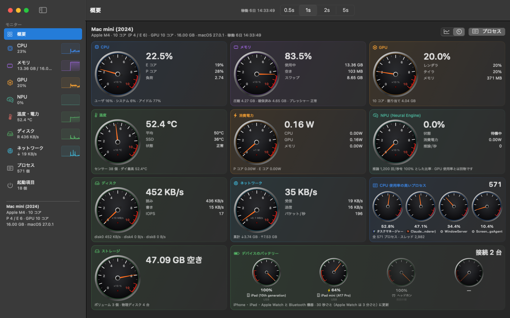

# タスクマネージャー for Mac

Windows のタスクマネージャーに相当する macOS 用のシステムモニタです。
Apple Silicon 向けに、**P コア / E コアの区別**、**ユニファイドメモリ**、**GPU 使用率**、
**温度**、**CPU / GPU 個別の消費電力**を表示します。

**管理者権限は不要**です（`powermetrics` のような sudo は要りません）。



対応機種: Apple Silicon 搭載 Mac（M1 以降）／ macOS 14 以降
開発・検証: M4 Mac mini (macOS 26.5)

## インストール

[Releases](https://github.com/zr750104/mac-task-manager/releases) から zip を落として
`MacTaskManager.app` を `/Applications` に入れてください（Finder では「タスクマネージャー」と表示されます）。
署名は ad-hoc のため、ダウンロード版は初回起動時に隔離属性の解除が必要な場合があります。

```bash
xattr -dr com.apple.quarantine "/Applications/MacTaskManager.app"
```

自分でビルドする場合は下の「ビルドと実行」を参照してください。ビルドすればこの操作は不要です。

アプリメニューの「アップデートを確認…」で新しいバージョンの有無を調べられます
（起動時にも 1 日 1 回だけ自動で確認します）。自動での入れ替えは行わず、
リリースページを開くところまでです。

---

## 画面

| 画面 | 内容 |
| --- | --- |
| **概要** | CPU / メモリ / GPU / 温度 / 消費電力 / NPU / ディスク / ネットワーク / 上位プロセス / ストレージ / **周辺機器のバッテリー**を 1 画面に集約 |
| **CPU** | 全体使用率、P/E コア別の使用率と推移、論理コアの個別グラフ、ロードアベレージ、チップ温度、CPU 消費電力 |
| **メモリ** | 内訳（アプリ / 確保済み / 圧縮 / キャッシュ）、メモリプレッシャー、スワップ、ページング統計、**メモリ解放** |
| **GPU** | デバイス / レンダラ / タイラの使用率、GPU が確保しているメモリ、GPU 消費電力 |
| **NPU** | Neural Engine の使用率・消費電力・推論リクエスト数、GPU との比較 |
| **温度・電力** | チップ温度・SSD 温度・センサー別一覧、CPU/GPU/メモリの消費電力、バッテリー（ノート型のみ） |
| **ディスク** | 読み書き速度、IOPS、**物理ディスク別の I/O（外付けを含む）**、各ボリュームの空き容量 |
| **ネットワーク** | 送受信速度、パケット数、インターフェース別 |
| **プロセス** | 全プロセス一覧（CPU / メモリ / スレッド / CPU 時間 / **ディスク読み書き** / ユーザ）、検索、並べ替え、終了・強制終了 |
| **起動項目** | ログイン時・OS 起動時に動くプログラムの一覧と、ユーザー領域の有効・無効切り替え |

更新間隔は 0.5 / 1 / 2 / 5 秒から選べます。ウィンドウは 480×320 まで縮小でき、
各画面のタイルは幅に応じて折り返します。

**概要**画面は 11 枚のカードが常に一画面に収まるよう、ウィンドウの高さから
カードの高さを逆算しています（スクロールしません）。カードをクリックすると各画面へ移動します。

右上のボタンで、推移を見る**グラフ表示**と、機械式タコメーター風の**メーター表示**を切り替えられます
（選んだ表示は次回起動時も引き継ぎます）。メーターは 0〜10（温度は 0〜11）の目盛りに倍率（「×10 %」など）を添え、
レッドゾーンに入ると文字盤の警告ランプが点きます。消費電力・ディスク・ネットワークは、
直近 2 分の最大値に合わせて倍率が自動で変わります。

### デバイスのバッテリー

概要画面の「デバイスのバッテリー」カードに、Mac につながっている機器の残量を表示します（30 秒ごとに更新）。

| 機器 | 読み取り方 | 条件 |
| --- | --- | --- |
| iPhone / iPad / iPod touch | Finder の同期と同じ仕組み（MobileDevice） | USB でつなぐか、Finder で「Wi-Fi 接続時にこのデバイスを表示」を有効にして同じネットワークにいること。機器側で一度「このコンピュータを信頼」していること |
| AirPods など Bluetooth 機器 | `system_profiler` | 接続中の機器。未接続でも最後に記録された残量があれば「前回の値」として薄く表示 |

機器名に加えて機種名（例：iPad mini (A17 Pro)）と接続の種類を表示するので、同じ種類の機器が複数あっても見分けられます。
メーター表示では、残量が少ないほど危ない向き（0〜20% がレッドゾーン）になります。

- 離れた場所にある iPhone や Apple Watch の残量（macOS の「バッテリー」ウィジェットに出るもの）は、Apple 製アプリ専用の仕組みのため読めません
- Logicool などのマウス・キーボードは残量を macOS に伝えないため表示されません
- MobileDevice は Apple が公開していない仕組みです。将来の macOS で読めなくなった場合は、カードが空になるだけでアプリは止まりません
- スクリーンショットの書き出しでは、機器名（本名が入りやすい）を機種名や一般名に置き換えます

### メニューバー常駐

CPU・メモリ・GPU・NPU・温度をメニューバーに常時表示できます（初期状態は CPU と温度）。
どの数値が何かを見分けられるよう、値の前に `CPU` `MEM` `GPU` `NPU` `TMP` の短いラベルが付きます。
クリックすると全項目の数値と、ウインドウ表示・常に最前面の切り替えが出ます。
表示する項目はメニュー内の「メニューバーに表示する項目」で選べます。

メニューバーに常駐している間は、ウインドウを閉じてもアプリは終了しません。

### ウィジェット

通知センターやデスクトップに置ける macOS 標準のウィジェットを用意しています（「システム状況」）。
デスクトップを右クリック →「ウィジェットを編集…」→「タスクマネージャー」で追加できます。

**利用には開発用証明書での署名が必要です。** macOS は証明書のないウィジェットの起動を許可しません。

1. Xcode →「設定…」→「Accounts」で Apple ID を追加（無料。有料の開発者登録は不要）
2. アカウントを選び「Manage Certificates…」→「+」→「Apple Development」
3. `./build.sh --install` を実行（証明書は自動で見つけて使います）

証明書が無い場合は ad-hoc 署名になり、アプリ本体は動きますがウィジェットは表示されません。
GitHub Releases の配布版も同じ理由でウィジェットは使えません。自分でビルドしてください。

**更新間隔は 5 秒**です（「モニター」メニュー →「ウィジェットの更新間隔」で 5 / 10 / 30 / 60 秒）。

ウィジェット自身が「1 分後に更新して」と頼んでも、macOS は「1〜15 分後のどこか」という幅でしか受け付けず、
1 日の回数にも上限（予算）があります。一方、ウィジェットを持つアプリ本体からの依頼は予算の対象外で即座に反映されるため
（chronod のログで `budget exempt reason: containerApp` を確認）、メニューバーに常駐しているアプリ本体から一定間隔で依頼しています。
ウィジェットが置かれていないときは依頼しません。負荷は 5 秒間隔で chronod とウィジェットを合わせて 1 コアの約 1% です。

**アプリ本体を終了すると、更新はシステム任せ（1〜15 分おき）に戻ります。**

App Sandbox の中で動くので、ウィジェット自身が計測できる CPU とメモリを表示しています。
CPU は前回の更新からの平均使用率です。

### 常に最前面

「モニター」メニュー →「常に最前面に表示」（⇧⌘T）またはメニューバーから切り替えます。
作業中も小さいウインドウを手前に置いたまま監視できます。

---

## 紹介資料

`docs/タスクマネージャー_使い方と機能紹介.pdf`（A4・15 ページ）に、
画面ごとの説明・使い方・実測データをまとめてあります。
資料内の画像は `docs/screenshots/` にも入っています。

### スクリーンショットの撮り直し

アプリ自身が自分のウインドウを描画して PNG を書き出します（画面収録の許可は不要）。

```bash
./build.sh
"./build/MacTaskManager.app/Contents/MacOS/MacTaskManager" --export-screenshots /tmp/shots
```

グラフに履歴を溜めるため 40 秒待ってから、全画面を 2 倍解像度で順に書き出します。
PDF を作り直すときは `docs/make_pdf.py` で HTML を生成し、
Chrome のヘッドレスモードで PDF に変換しています。

**注意:** サイドバーとツールバーは半透明マテリアル（`NSVisualEffectView`）の上にあり、
この方法では描画されず白く抜けます。資料ではその部分を切り取って使っています。

## ビルドと実行

```bash
./build.sh --run
```

`build/MacTaskManager.app` が生成され、そのまま起動します。
`./build.sh --install` で `/Applications` にインストールします。

必要なもの: macOS 14 以降、Xcode またはコマンドラインツール（`xcode-select --install`）。
外部ライブラリへの依存はありません。

### 別の Mac（M1 MacBook Air など）で使う

**プロジェクトごとコピーして、その Mac 上で `./build.sh` を実行してください。**

```bash
# 例: プロジェクトフォルダを M1 Air にコピーしたあと
cd "TaskManger for MAC"
./build.sh --install
```

ビルド済みの `.app` をコピーしても動きますが、ネットワーク経由や USB で持ち込むと
macOS の隔離属性が付いて起動を拒まれることがあります。その場合は次で解除できます。

```bash
xattr -dr com.apple.quarantine "/Applications/MacTaskManager.app"
```

機種の違いはコード側で吸収しています。

| | M4 Mac mini | M1 MacBook Air |
| --- | --- | --- |
| コア構成 | 4P + 6E（自動検出） | 4P + 4E（自動検出） |
| GPU | 10 コア | 7 または 8 コア |
| 温度センサー | `PMU tdie` 系（ダイ全体） | `pACC` / `eACC` / `GPU MTR` 系（**CPU・GPU 個別に表示されます**） |
| バッテリー画面 | 非表示（バッテリー無し） | 残量・充放電電力・劣化・温度を表示 |
| ファン | 非公開のため表示なし | ファンレスのため元々なし |

M1 Air のほうがセンサー名が具体的なので、温度は M4 より細かく出ます。

---

## 構成

```
Sources/MacTaskManager/
├── MacTaskManagerApp.swift      アプリのエントリポイント
├── AppSettings.swift            最前面表示・メニューバー設定（UserDefaults）
├── MenuBarController.swift      メニューバー常駐
├── UpdateChecker.swift          GitHub Releases の更新確認
├── Core/                        リングバッファ、数値フォーマッタ
├── Monitors/                    計測層（UI に依存しない）
│   ├── SystemInfo.swift         マシン情報、CPU クラスタ構成
│   ├── CPUMonitor.swift         host_processor_info の tick 差分
│   ├── MemoryMonitor.swift      host_statistics64 / vm.swapusage
│   ├── GPUMonitor.swift         IOAccelerator の PerformanceStatistics
│   ├── TemperatureMonitor.swift IOKit HID の温度センサー
│   ├── PowerMonitor.swift       IOReport の Energy Model
│   ├── NeuralEngineMonitor.swift ANE の電力と割り込み回数（NPU 画面）
│   ├── MemoryReclaimer.swift    purge（管理者権限つき）
│   ├── BatteryMonitor.swift     AppleSmartBattery
│   ├── NetworkMonitor.swift     getifaddrs の if_data
│   ├── DiskMonitor.swift        IOBlockStorageDriver の Statistics（物理ディスク別）
│   ├── StartupMonitor.swift     LaunchAgents / LaunchDaemons と launchctl
│   ├── ProcessMonitor.swift     sysctl KERN_PROC_ALL + libproc + ps
│   └── MetricsEngine.swift      収集の駆動と時系列の保持
└── Views/                       SwiftUI の画面
```

計測は `actor Sampler` 上で行い、メインスレッドを止めません。

---

## 温度センサーについて（実測で特定）

M4 Mac mini が公開するセンサー名は `PMU tdie1〜14` のような汎用名で、
**CPU / GPU と明示された名前がありません**。そこで実機で
**CPU 全コア負荷 30 秒**と **GPU 負荷（Metal）30 秒**をかけ、
各センサーの上昇幅を測って分類しました。

| センサー | CPU 負荷での上昇 | GPU 負荷での上昇 | 判定 |
| --- | --- | --- | --- |
| `PMU tdie1` | **+14.7℃** | +7.0℃ | SoC ダイ（CPU 寄り） |
| `PMU tdie6` | +13.1℃ | +9.3℃ | SoC ダイ |
| `PMU tdie2` | +7.7℃ | **+10.2℃** | SoC ダイ（GPU 寄り） |
| `PMU tdev1〜8` | +2〜4℃ | +1〜4℃ | 電源部 |
| `PMU2 tdie*` | +1℃ 前後 | +1℃ 前後 | 別ドメイン（基板側） |
| `NAND CH0 temp` | +1.0℃ | **+0.0℃** | **SSD** |
| `PMU tcal` / `PMU2 tcal` | **+0.0℃** | **+0.0℃** | 校正用の基準値 → 一覧から除外 |

**結論:**

- **SSD 温度は独立して取得できます**（`NAND CH0 temp`）。CPU / GPU 負荷では動きません。
- **CPU と GPU の温度は分離できません。** Apple Silicon は CPU と GPU が同じダイに載っており、
  `tdie` センサーはダイ上に分散しているだけで、どちらの負荷でも上昇します。
  これは実装の制約ではなく物理的な構成によるものです。
- そのため本アプリでは「SoC ダイ（CPU・GPU 共通）」としてまとめ、
  **どちらが働いているかは消費電力で判別**できるようにしています。
- `tcal` は温度としては常に一定値なので一覧から除外しています。

M1 / M2 のノート型は `pACC MTR Temp Sensor`（P コア）、`eACC`（E コア）、`GPU MTR` という
名前でセンサーを公開するため、その機種では CPU / GPU 別に表示されます。分類は名前で自動判定します。

### 外付けドライブの温度は取得できません

USB 接続の外付け SSD（実測: WD Blue SN5000 1TB を Ugreen の USB ケースに収納）で確認した結果:

| 確認項目 | 結果 |
| --- | --- |
| macOS の SMART 対応 | `SMART Status: Not Supported`（内蔵は `Verified`） |
| IOKit の温度プロパティ | 該当なし（内蔵は `AppleEmbeddedNVMeTemperatureSensor` を持つ） |
| 接続 | USB (UAS)、`bInterfaceProtocol` = 0x62 |

macOS の USB マスストレージドライバが SAT（SCSI/ATA 変換）パススルーを実装していないため、
ドライブ自身が持つ温度センサーに到達できません。Thunderbolt / NVMe 直結のケースであれば
取得できる可能性があります。

代わりに**ディスク画面で物理ディスクごとの読み書き速度**を表示しており、
外付けドライブのアクセス状況はそこで確認できます。

---

## 消費電力について

`IOReport` の "Energy Model" グループから、**管理者権限なし**でブロック別の消費電力を取得しています。
温度と違い、CPU と GPU は個別に計測されています。

M4 Mac mini での取得例（アイドル寄りの状態）:

```
GPU    5.92 W
CPU    2.08 W  （P コア 1.31 W / E コア 1.21 W）
DRAM   1.12 W
```

175 チャンネルの購読で 1 回あたり約 2ms と軽量です。

---

## Neural Engine（NPU）について（実測で特定）

NPU は GPU と混同されやすいため、**独立した画面**にしています。
NPU 画面には GPU 使用率と並べた比較バーも置いてあり、別々に動くことがひと目で分かります。

### GPU 使用率は NPU の使用率ではありません

GPU（グラフィックス）と NPU（Neural Engine）は、同じダイに載っていますが**まったく別のハードウェア**です。
実際に NPU だけを 8 スレッドで全力稼働させて計測しました。

| 指標 | アイドル | NPU 全力稼働時 |
| --- | --- | --- |
| ANE 消費電力（最大） | 0.000 W | **2.000 W** |
| GPU 使用率（平均） | 22.3 % | 25.2 % |

NPU の電力は 0 W から 2 W へ跳ね上がったのに対し、**GPU 使用率はほとんど動きませんでした**
（わずかな増加は Vision の画像前処理とノイズによるもの）。

### 使用率の求め方

**Apple は GPU の「デバイス使用率」に相当する NPU の稼働率を公開していません。**
root で `powermetrics` を動かしても電力しか出ず、IOReport にも ANE の
DVFS residency（動作周波数ごとの滞留時間）は含まれていません。

そこで実機で Vision の画像分類（`VNClassifyImageRequest`）を実行し、
反応するチャンネルを調べました。

| チャンネル | アイドル（8秒） | 負荷時（8秒） | 倍率 |
| --- | --- | --- | --- |
| `Energy Model` の `ANE` | 37 mJ | **12,144 mJ** | 約 328 倍 |
| `ane 0` の割り込み回数 | 3 回 | **9,642 回** | 約 3,200 倍 |
| `AMC Stats` の `ANE NRT AF WR` | 19 MB | **812 MB** | 約 42 倍 |

この結果をもとに、**使用率 = ANE 消費電力 ÷ 基準電力** として CPU と同じ % 表示にしています。

- 基準の **2.0 W** は、この Mac で Vision を 8 スレッド並列で回したときの実測ピークです
- これを超える電力を観測した場合は基準を自動で引き上げ、次回起動時も引き継ぎます
- GPU 画面の「基準を戻す」ボタンで既定値に戻せます

ハードウェアが報告する稼働率そのものではありませんが、CPU 使用率と同じ感覚で読める値になります。
併せて **消費電力（W）** と **推論リクエスト/秒**（ANE からの割り込み回数）も表示しています。

---

## メモリ解放について

メモリ画面の「解放する」ボタンは macOS の `/usr/sbin/purge` を実行します。

`purge` は setuid されておらず、権限なしで実行すると
`Unable to purge disk buffers: Operation not permitted` になるため、
**管理者パスワードの入力ダイアログ**を出して実行します。
パスワードは macOS の認証ダイアログが受け取るので、このアプリが触ることはありません。

**この操作はファイルのキャッシュを捨てるもので、アプリが使用中のメモリは減りません。**
キャッシュが消えるぶん直後はファイルの読み込みが一時的に遅くなります。
macOS はメモリを自動で管理するため通常は不要で、
メモリ不足の解消には使っていないアプリを終了するほうが効果的です。
確認ダイアログにも同じ説明を出しています。

---

## 実装メモ

実測して判明した、ドキュメントからは読み取りにくい挙動を記録しておきます。

### 1. プロセスの CPU 時間は「タスク累積 + 実行中スレッド」で求める必要がある

`proc_pidinfo(PROC_PIDTASKINFO)` の `pti_total_user` / `pti_total_system`、および
`proc_pid_rusage` の `ri_user_time` / `ri_system_time` は、**終了済みスレッドの分しか含みません**。

実測（2 秒間の差分）:

| プロセス | PROC_PIDTASKINFO | proc_pid_rusage | スレッド単位の合計 | `top` の値 |
| --- | --- | --- | --- | --- |
| AMPDevicesAgent | 2.4% | 2.4% | **100.1%** | 97.1% |
| Claude Helper (Renderer) | 0.6% | 0.6% | **25.5%** | 16.0% |

そのため `PROC_PIDLISTTHREADS` + `PROC_PIDTHREADINFO` で実行中スレッドの CPU 時間を合算しています。
全 750 プロセス・3,300 スレッドを走査しても約 2.5ms で済みます。

### 2. 論理 CPU 番号は「E コアが先、P コアが後」

M4（P 4 + E 6）で高 QoS のスレッドを 4 本回したところ、index 6〜9 が 98% に張り付きました。
つまり `host_processor_info` の並びは **性能の低いクラスタから先**です。
`hw.perflevel0` が最高性能クラスタなので、`hw.nperflevels - 1` から 0 へ逆順に走査すると
インデックス順と一致します（`SystemInfo.load()`）。

### 3. root 所有プロセスは `/bin/ps` 経由で取る

`libproc` は他ユーザーのプロセスに対して EPERM を返します（実測で 750 件中 180 件）。
一方 `/bin/ps` は **setuid root**（`-rwsr-xr-x root wheel`）なので、権限昇格なしに正確な値が得られます。

ただし `ps` の `%cpu` 列は**生涯平均**で現在の負荷を表さないため、
累積 CPU 時間の `time=` 列だけを借りて自前で差分を取っています。
これにより WindowServer などの値が `top` と一致します（45.3% vs 46.5%）。

### 4. `Foundation.Process` は毎秒の計測には重すぎる

`ps` の実行に `Foundation.Process` を使うと 1 回あたり約 96ms かかります。
`posix_spawn` を直接呼ぶと約 25ms になり、プロセス一覧の収集全体が **110ms → 44ms** になりました。

### 5. IOKit の Get 系関数は +0 で返る

`IOReportChannelGetGroup` などは所有権を渡さない（+0）ため、
`takeRetainedValue()` を使うと過剰解放でクラッシュします。`takeUnretainedValue()` が正解です。

### 6. ウィジェットを自前でビルドするときの落とし穴

SwiftPM は `.appex` を作れないため、`build.sh` で `swiftc` を直接使ってウィジェット拡張を作っています。
Xcode が自動でやっていることを手で再現する必要があり、次の 3 点で詰まりました。

1. **開発用証明書が必要。** ad-hoc 署名だと RunningBoard が `Client not authorized` で起動を拒否する
2. **アプリのファイル名に濁点を含む日本語を使えない。** 「ジ」が「シ」＋濁点に分解されて記録され、
   起動時に Launch Services から拡張の記録を引けず（`-10814`）、結局 `Client not authorized` になる。
   ファイル名は `MacTaskManager.app` にし、表示名だけ `InfoPlist.strings` で日本語にしている
3. **起動の入口を `_NSExtensionMain` にする必要がある**（`-Xlinker -e -Xlinker _NSExtensionMain`）。
   Swift の `@main` のままだとシステムから渡される `-LaunchArguments` が読まれず、
   `ExtensionMain.shared.launchArguments` が空のまま ExtensionFoundation の中で停止する

また chronod は `CFBundleVersion` が同じだと「前と同じ拡張」とみなして読み直さないため、
`build.sh` はビルドのたびにビルド番号を日時で振り直しています。

### 7. `product-name` は `IODeviceTree:/product` にある

「Mac mini (2024)」のような製品名は `IOPlatformExpertDevice` ではなく
デバイスツリーの `/product` ノードに入っています。

---

## 精度について

計測値は `top` と突き合わせて検証しています。

- **CPU 全体**: `top` が user 23.86% / sys 16.86% / idle 59.26% のとき、本アプリは user 23.4% / sys 15.8% / idle 60.8%
- **プロセス別 CPU**: AMPDevicesAgent 98.2%（`top` 97.1%）、WindowServer 46.2%（46.3%）、AirPlayXPCHelper 23.4%（23.3%）

プロセスの CPU 合計はホスト全体の使用率より小さくなります。
`kernel_task`（PID 0）と割り込み処理を計上できないためで、Activity Monitor でも同様です。

プロセスの「メモリ」列は物理フットプリント（`ri_phys_footprint`）です。
共有メモリが重複計上されるため、合計が物理メモリ量を超えることがあります（Activity Monitor と同じ挙動）。

---

## 本アプリ自身の負荷

M4（10 コア）／約 750 プロセスの環境で、1 コアに対する割合:

| 状態 | CPU |
| --- | --- |
| グラフ画面（更新間隔 1 秒） | 約 4〜6% |
| プロセス画面（更新間隔 1 秒） | 約 10% |
| プロセス画面（更新間隔 5 秒） | 約 3% |

プロセス一覧の収集はプロセス画面を開いているときだけ動き、最短 2 秒間隔に間引かれます。
温度（1 回約 50ms）とバッテリーも 2 秒間隔です。
ノート型でバッテリー駆動中に常用する場合は、更新間隔を 2 秒か 5 秒にするのがおすすめです。

---

## 既知の制限

- **CPU と GPU の温度は分離できません。** 同一ダイのためで、代わりに消費電力で判別してください（上記参照）。
- **ファン回転数は表示しません。** M4 Mac mini では IORegistry に公開されていませんでした。
  （M1 MacBook Air はファンレスなので元々ありません）
- **外付けドライブの温度は取得できません。**（上記参照）
- **`kernel_task`（PID 0）は一覧に出ません。** CPU 時間を取得する手段がなく、0% と表示すると誤解を招くため除外しています。
- **起動項目で変更できるのは自分のユーザー領域だけです。** `/Library/LaunchAgents` と
  `/Library/LaunchDaemons` は管理者権限が要るため表示のみです。また macOS のシステム設定にある
  「ログイン時に開く」のアプリ一覧は OS 内部のデータベース管理で、権限なしには読み出せないため含まれません。
- **プロセスのディスク I/O は自分が参照できるプロセスのみ**表示されます（root 所有のものは「—」）。
- **プロセスの終了は自分が所有するものだけ可能です。** root 所有プロセスに対しては権限エラーを表示します。
- **温度と電力は非公開 API を使っています。** IOKit HID の温度センサーと `libIOReport` は
  Apple が正式に文書化していないため、将来の macOS で取得できなくなる可能性があります。
  その場合はアプリが該当の表示だけを自動的に無効化し、他の機能は通常どおり動作します。
- メモリプレッシャーの数値は「(確保済み + 圧縮) ÷ 物理メモリ」で算出した独自指標です。
  正常 / 警告 / 危険のラベルはカーネルの判定（`kern.memorystatus_vm_pressure_level`）を使っています。
